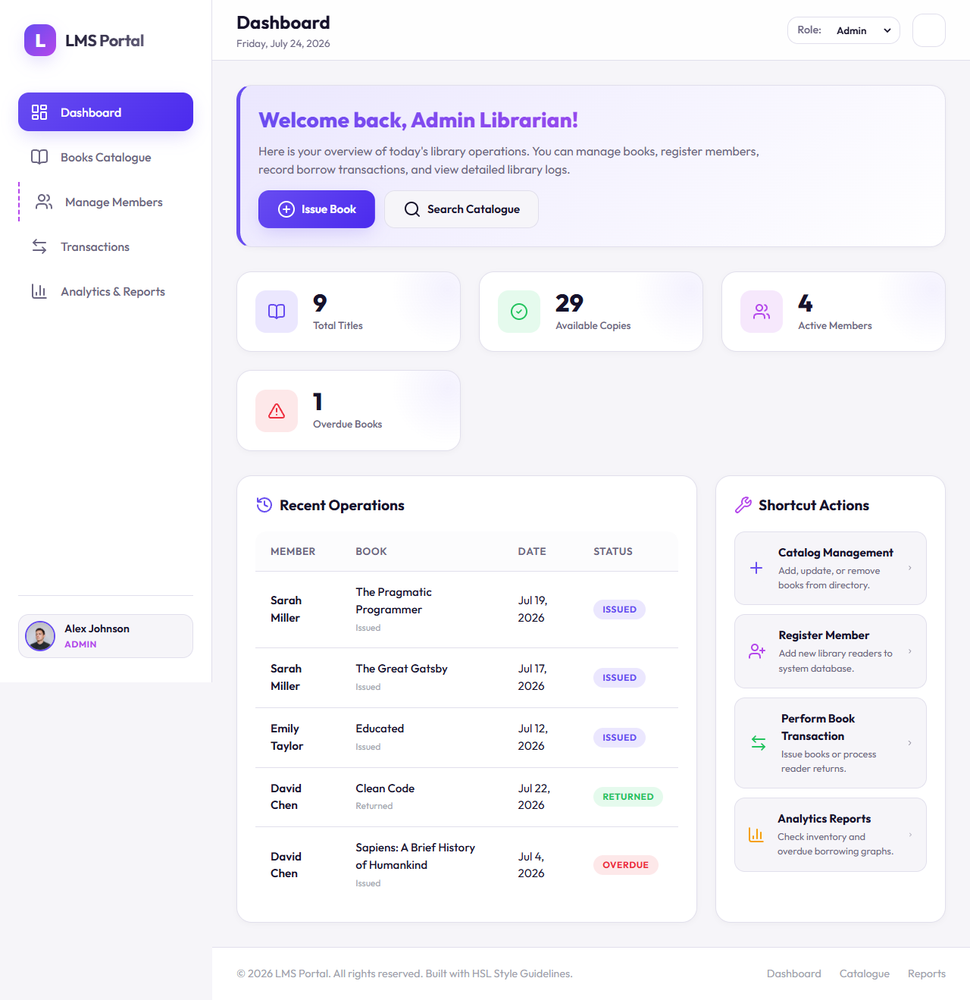
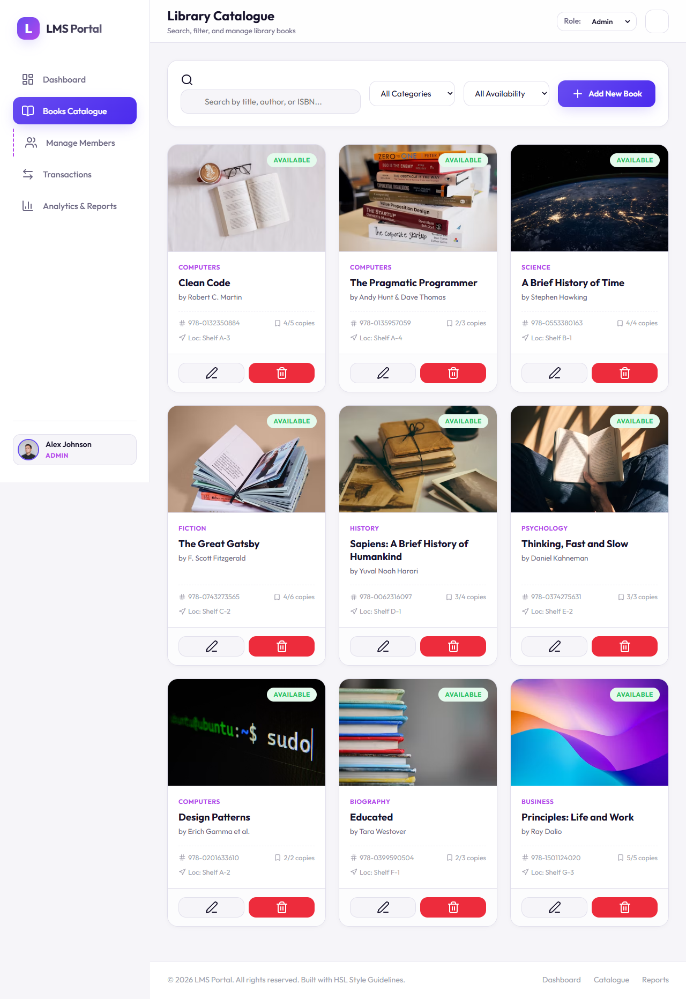
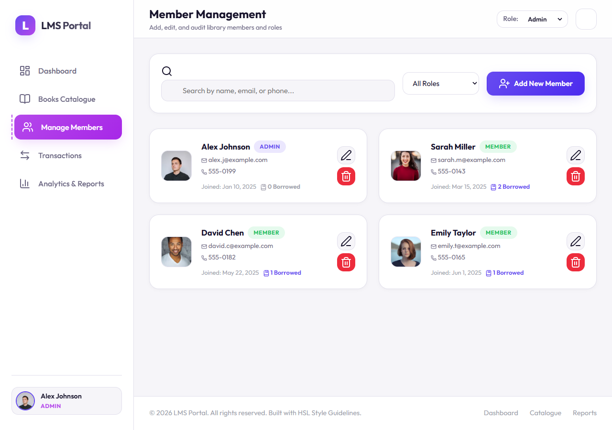
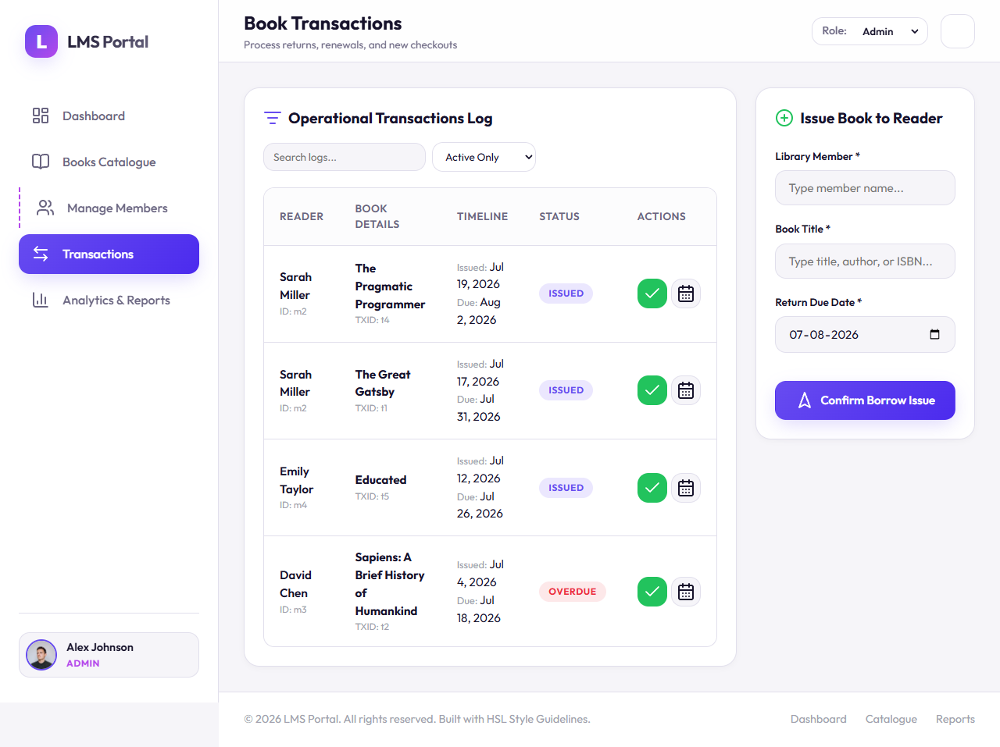
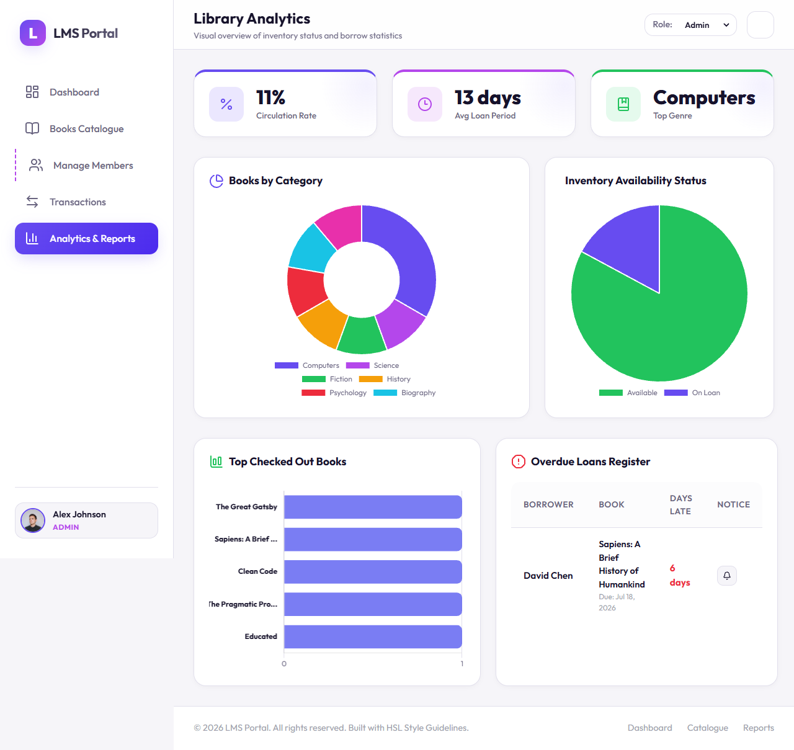

<div align="center">

# 📚 LMS Portal

### A brighter way to manage your library

A colorful, responsive library dashboard for managing your catalogue, members, book loans, and analytics — all in one place.

[](https://developer.mozilla.org/en-US/docs/Web/HTML)
[](https://developer.mozilla.org/en-US/docs/Web/CSS)
[](https://developer.mozilla.org/en-US/docs/Web/JavaScript)
[](https://github.com/alexverma180-gif/WEB-LMS)

[Explore the source](https://github.com/alexverma180-gif/WEB-LMS) · [Open an issue](https://github.com/alexverma180-gif/WEB-LMS/issues)

</div>

## ✨ Features

| 📊 Dashboard | 📖 Catalogue | 👥 Members | 🔄 Transactions | 📈 Reports |
|:--|:--|:--|:--|:--|
| Activity and summary stats | Search and manage titles | Manage library members | Track loans, returns, overdue books | Explore charts and metrics |

- 🎨 Light and dark themes.
- 🪄 Admin and Member demo views with a role selector.
- 💾 Changes are saved in browser local storage on that device.
- 📱 Responsive layout for desktop and smaller screens.

## 🖼️ Screenshots

| Dashboard | Book catalogue | Members |
|:--:|:--:|:--:|
|  |  |  |

| Transactions | Reports |
|:--:|:--:|
|  |  |

## 🚀 Run locally

**Requirements:** Node.js and npm.

```bash
npm install
npm run dev
```

Open [http://localhost:3000](http://localhost:3000).

## 🗂️ Project structure

```text
WEB-LMS/
├── css/                 # App styles and components
├── js/                  # Dashboard, catalogue, members, transactions, reports
├── screenshots/         # App previews
├── index.html           # Dashboard
├── books.html           # Book catalogue
├── members.html         # Member management
├── transactions.html    # Loan and return tracking
├── reports.html         # Analytics and reports
└── Project_Report_LMS.pdf
```

## ℹ️ About this demo

This front-end demo uses sample data and browser local storage, not a shared server or database. Clearing this browser's site data resets locally saved changes.

[Read the project report](Project_Report_LMS.pdf).
